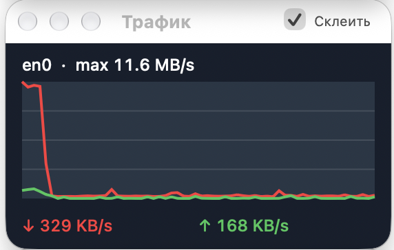
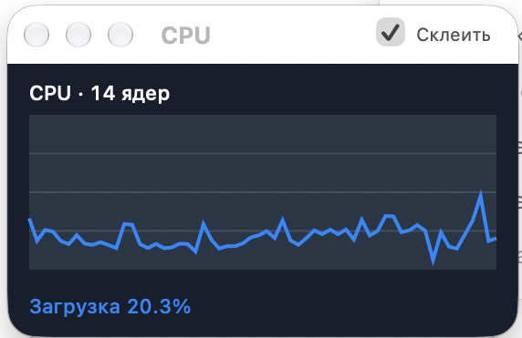
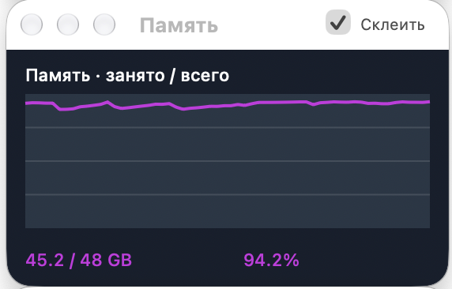
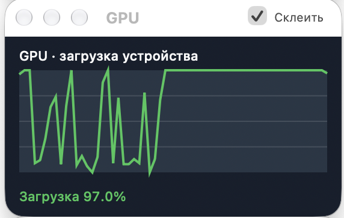
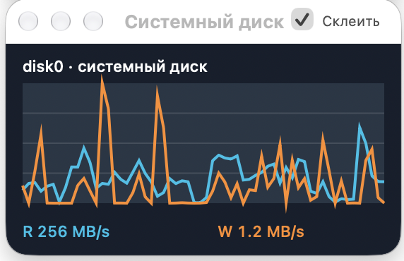
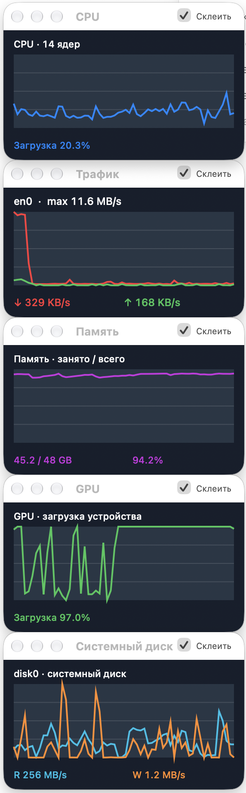

<p align="center">
  
</p>

# NetMeter для macOS

[English](README.md) · [Русский](README.ru.md)

## [⬇ Скачать для macOS (.dmg)](https://github.com/Coloded/NetMeter_MacOS/releases/latest/download/NetMeter-stable.dmg)

macOS 13+ · Apple Silicon и Intel · [Что нового](https://github.com/Coloded/NetMeter_MacOS/releases/latest)

Нативный монитор macOS с отдельными графиками сети, памяти, CPU, GPU и системного
диска поверх других окон. Располагайте их рядом с рабочими приложениями,
склеивайте в группы или оставляйте только нужные показатели.

## Возможности

- **Сеть:** скорость загрузки и отдачи на графике и в строке меню.
- **Автоматический выбор интерфейса:** определение основного подключения на
  текущем Mac, отслеживание смены сети и ручной выбор интерфейса.
- **CPU:** общая загрузка или сетка отдельных графиков логических ядер.
- **Память:** занятый объём, общая ёмкость и история использования.
- **GPU:** включается только при наличии доступного показателя загрузки.
- **Системный диск:** определение физического накопителя загрузочного тома,
  скорости чтения и записи.
- **Отдельные окна:** свои меню, сохранение положения и размера, прозрачность
  и расположение поверх других окон.
- **Склейка:** соединение графиков любой стороной и перемещение группы.
- **Четыре языка приложения:** русский, английский, арабский и упрощённый китайский.
- **Подписанные обновления:** Sparkle 2.9.2 с проверкой ленты и архива.

## Графики

Реальные снимки приложения, нарезанные из предоставленного скриншота с русским
интерфейсом. У каждого графика своё контекстное меню; остальные графики включаются
и скрываются из строки меню macOS.

### Сеть



Красная линия — загрузка, зелёная — отдача. Основное физическое подключение
определяется на текущем Mac и отслеживается при смене сети. VPN или другой
интерфейс можно выбрать вручную. График учитывает проходящий через него трафик.


Эти же текущие скорости доступны в строке меню, даже когда окно графика скрыто.

### CPU



Показывает общую загрузку процессора. Правый клик → **«Показать все ядра»**
включает отдельные графики логических ядер в одном окне. При увеличении окна
увеличиваются и графики; выключение этого режима возвращает стандартный размер.

### Память



Показывает занятый объём, общую физическую память и процент использования.
Фиолетовая линия помогает видеть длительную нагрузку и изменения потребления.

### GPU



Показывает загрузку графического устройства при наличии доступного датчика.
На Mac, где необходимые показатели недоступны, график GPU не включается.

### Системный диск



Автоматически определяет физический накопитель загрузочного тома. Голубая
линия — чтение, оранжевая — запись в байтах в секунду. Другие подключённые
накопители не прибавляются к этому графику.

<details>
<summary>Пример: все пять окон склеены в вертикальную группу</summary>
<p></p>
</details>

## Требования и установка

- macOS 13 Ventura или новее.
- Apple Silicon или Intel. По умолчанию собирается Universal-приложение.

Для установки выпуска скачайте `NetMeter-stable.dmg` из раздела [**Releases**](https://github.com/Coloded/NetMeter_MacOS/releases/latest) этого
репозитория, откройте образ и перетащите **NetMeter.app** в **Applications**.

Приложение работает в строке меню. В разделе **«Графики»** можно включить и скрыть
каждое окно. GPU недоступен, если система не предоставляет необходимые данные.

## Управление

Рядом с интерфейсом показана согласованная скорость Ethernet или TX-скорость соединения Wi-Fi; данные обновляются каждые пять секунд. Wi-Fi TX — скорость радиосоединения на передачу к точке доступа, не скорость копирования файлов. Если macOS не сообщает скорость, показано «скорость соединения недоступна». Трафик измеряется в двоичных KiB/s, MiB/s и GiB/s, скорость соединения — в десятичных Мбит/с и Гбит/с.

В строке меню скорость показана в два ряда: загрузка сверху, отдача снизу, с полными единицами скорости. Наведите указатель, чтобы увидеть интерфейс, текущие скорости и объём трафика за сеанс и всё время.

Включите **Основные → Запускать при входе в систему**, чтобы NetMeter открывался при входе в macOS. Галочка отражает реальное состояние «Объектов входа»; если требуется разрешение, появится кнопка системных настроек. Перед включением перенесите NetMeter в «Программы».

Правая кнопка по графику → **Цвет → График / Подпись** открывает системную палитру macOS с пипеткой. Для сети и диска раздельно настраиваются обе линии и их подписи. Цвет заголовка также можно изменить. Цвета сохраняются после перезапуска.

В **Основные → Стиль приложения** можно выбрать **Классический** (тёмные графики) или **macOS** (светлая/тёмная тема системы). Изменение сразу применяется ко всем графикам, включая отдельные ядра CPU.

Клик по области графика открывает «Мониторинг системы». Для автоматического выбора нужного раздела или истории GPU разрешите NetMeter **Универсальный доступ** в системных настройках. Без разрешения приложение откроется в текущем разделе. Перетаскивайте окна за заголовок.


| Действие | Как выполнить |
|---|---|
| Показать или скрыть график | Строка меню → **«Графики»** |
| Настроить один график | Правый клик по этому графику |
| Посмотреть отдельные ядра | Правый клик по CPU → **«Показать все ядра»** |
| Увеличить графики | Растянуть окно за край или выбрать **«Увеличить это окно»** |
| Вернуть компактный CPU | Снять **«Показать все ядра»** |
| Склеить окна | Включить **«Склеить»** и подвести окно к краю другого |
| Переместить группу | Потянуть любое приклеенное окно |
| Переставить один график | **Option + перетаскивание** либо **«Отклеить это окно»** |
| Переключить язык | Строка меню → **«Язык»** |

Положение, размер и видимость окон, а также язык сохраняются. При смене языка
обновляются меню, заголовки окон, настройки и подписи графиков. Для арабского
используется направление меню и настроек справа налево.

Автоматический режим выбирает основное физическое подключение, когда его удаётся
определить. Его показатели включают локальный трафик и передачу VPN-туннеля.
Для просмотра трафика внутри VPN можно вручную выбрать его интерфейс. При
отсутствии маршрута приложение показывает отсутствие подключения и не подставляет `en0`.

## Сборка из исходников

Нужны Apple Command Line Tools и Python 3.9 или новее:

```bash
xcode-select --install
bash build.sh
open NetMeter.app
```

Скрипт сам находит установленный SDK, скачивает закреплённую версию Sparkle,
проверяет SHA-256, создаёт иконку и подписывает приложение локальной ad-hoc подписью.
Результаты сборки и скачанные зависимости исключены из Git.

Сборка под одну архитектуру:

```bash
NETMETER_ARCH=arm64 bash build.sh
# либо NETMETER_ARCH=x86_64 bash build.sh
```

## Структура проекта

```text
Sources/NetMeter/
  App/             Запуск и жизненный цикл
  Monitoring/      Определение сети и сбор системных показателей
  Models/          Образцы показателей и форматирование
  Graphs/          Отрисовка сети, ресурсов и отдельных ядер
  Windows/         Окна, сохранение положения и склейка
  Menus/           Строка меню и команды конкретного графика
  Settings/        Настройки и окно «О программе»
  Localization/    Выбор языка и направление интерфейса
  Updates/         Интеграция Sparkle
Resources/
  Localization/    Переводы en, ru, ar и zh-Hans в папках .lproj
  Branding/        Векторный логотип и PNG-иконка
  AppIcon.icns     Иконка приложения macOS
scripts/           Сборка и подготовка подписанных выпусков
Tests/             Проверки маршрутов, переводов и обновлений
updates/           Публичная конфигурация обновлений и изменения
docs/              Инструкция по обновлениям и скриншоты
```

## Проверки и обновления

```bash
python3 Tests/test_localization.py
bash build.sh --probe
python3 Tests/test_updates.py --dmg
```

Диагностика проверяет сценарии выбора интерфейса, местные датчики и склейку.
Тест обновлений использует временные локальные файлы и проверяет отказ при
изменении ленты или архива. Для него нужен ключ этого приложения в местном Keychain.

Обновления используют подписанную ленту из [GitHub Releases](https://github.com/Coloded/NetMeter_MacOS/releases).
Настройка, хранение ключа и выпуск описаны в
[инструкции по обновлениям](docs/updates.md). Скрипты сборки ничего не публикуют.

Сейчас используется ad-hoc подпись. Developer ID и notarization настраиваются
отдельно перед распространением соответствующих подписанных выпусков.

Реальные проверки выполнены на Mac разработчика с Apple Silicon. Код для Intel
включён в Universal-сборку; проверка на другом физическом Mac ещё требуется,
прежде чем заявлять о подтверждённой работе на этом оборудовании.

## Сторонние компоненты

[Sparkle](https://sparkle-project.org/) распространяется по
[включённой лицензии](Resources/ThirdParty/Sparkle-LICENSE.txt).
